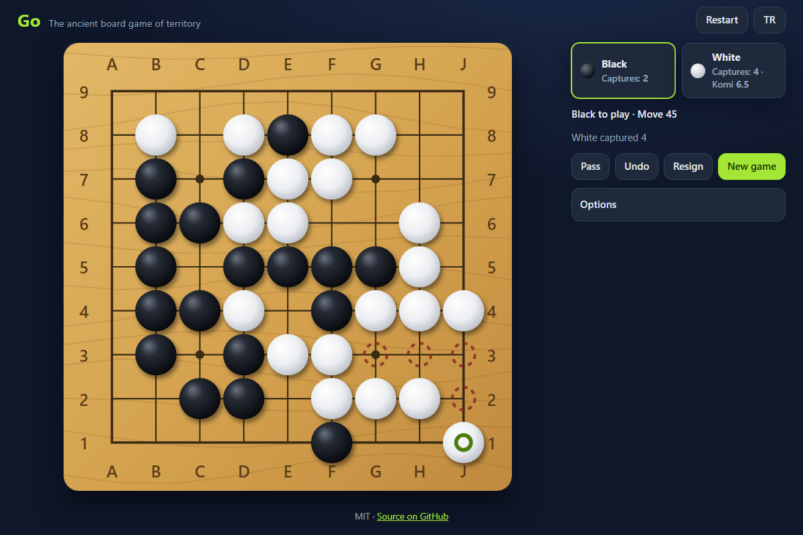

# Go - the ancient board game of territory, in your browser, against a friend or a Monte Carlo computer player

[](#tests)
[](LICENSE)

**▶ Play now: https://celaldrg.github.io/go-game/**



## Features

- 9x9, 13x13 and 19x19 boards on a hand-drawn wooden SVG board with coordinates (A-T without I, rows counted from the bottom)
- Two players on one device, or against the computer (easy, medium, hard on 9x9 and 13x13; easy on 19x19)
- Full rules: captures, suicide is illegal, positional superko (Zobrist hashing, covers the simple ko), passing, resignation
- Handicap 2-9 stones on the star points (up to 5 on 9x9) and komi 0.5 / 5.5 / 6.5 / 7.5
- Area scoring with a dead-stone phase: the app proposes the dead groups, you tap to correct them, then see a score breakdown
- Computer player: Monte Carlo tree search (UCT) with eye-respecting random playouts and capture/atari priors, running in a Web Worker so the page never freezes
- Undo, optional move numbers, SGF download and upload
- Last move and recent captures marked, ghost stone on hover, "tap twice to place" for small points on phones
- English and Turkish, dark theme, no dependencies, no tracking

## How to play

Players take turns placing stones on the intersections; black moves first. A group of stones with no empty neighbouring point is captured. You may not play a move that leaves your own group without liberties (unless it captures), nor one that repeats an earlier board position. When both players pass in a row, mark the dead groups and confirm the score: your stones plus the empty points only you surround, plus komi for White.

| Action | Keyboard | Touch / mouse |
| --- | --- | --- |
| Move the cursor | Arrow keys | - |
| Place a stone | Enter or Space | Tap / click a point (tap twice when "tap twice to place" is on) |
| Pass | P | Pass button |
| Undo | U | Undo button |
| Mark dead groups (after two passes) | Enter on a stone | Tap a group |

Resign asks for a second click to confirm. New game opens the setup (board size, mode, level, your colour, handicap, komi); Restart starts again with the same settings.

## Run locally

It is a static site, but ES modules need `http://`, not `file://`. Serve the folder with any static server, for example:

```sh
npx serve .
```

and open the printed address. Add `?demo` to the URL for the deterministic mid-game position used for the screenshot.

## Tests

```sh
node --test
```

Node 22, no packages to install. The suite covers captures (single stones and groups in the middle, on edges, in corners, two groups at once), the suicide rule and capturing moves into a point without liberties, simple ko and positional superko in a non-ko repetition, area scores of three hand-counted finished 9x9 positions, the dead-stone proposal in three positions, SGF export/import round trips, the computer finding captures in five tactical positions, the computer beating a random player in at least 19 of 20 seeded 9x9 games, the hard level staying under 1.5 s per move in the opening of a seeded game, and the English/Turkish string tables.

## Project structure

```
index.html            page, dialogs, Open Graph tags
style.css             dark theme and responsive layout
src/board.js          board, chains, liberties, Zobrist hashing
src/game.js           rules, superko, passes, undo, scoring phase
src/score.js          area scoring, ownership estimate, dead stones
src/playout.js        random playouts that keep their own eyes
src/ai.js             Monte Carlo tree search player
src/sgf.js            SGF export and import
src/rng.js            seeded random numbers
src/demo.js           ?demo position
src/storage.js        safe localStorage helper
src/i18n.js           English and Turkish strings
src/main.js           UI wiring, keyboard, worker
src/board-view.js     SVG board renderer
src/setup-dialog.js   new game dialog
src/ai-worker.js      Web Worker for the computer
test/                 node:test suites
```

## License

[MIT](LICENSE) © 2026 Celalettin Durgaç

---

## Türkçe

Go: toprak kapmanın kadim tahta oyunu; tarayıcıda, bir arkadaşa ya da Monte Carlo bilgisayar oyuncusuna karşı.

**▶ Hemen oyna: https://celaldrg.github.io/go-game/**

### Özellikler

- Koordinatlı (I harfi olmadan A-T, satırlar alttan sayılır) ahşap görünümlü SVG tahtada 9x9, 13x13 ve 19x19
- Aynı cihazda iki oyuncu ya da bilgisayara karşı (9x9 ve 13x13'te kolay, orta, zor; 19x19'da kolay)
- Tüm kurallar: taş alma, intihar hamlesi yasağı, konumsal süperko (Zobrist hash, basit ko'yu da kapsar), pas, çekilme
- Yıldız noktalarına 2-9 handikap taşı (9x9'da en çok 5) ve 0,5 / 5,5 / 6,5 / 7,5 komi
- Ölü taş aşamalı alan sayımı: uygulama ölü grupları önerir, dokunarak düzeltirsin, sonra skor dökümünü görürsün
- Bilgisayar oyuncusu: gözleri doldurmayan rastgele oyunlarla ve taş alma/atari öncelikleriyle Monte Carlo ağaç araması (UCT); Web Worker'da çalışır, sayfa donmaz
- Geri alma, isteğe bağlı hamle numaraları, SGF indirme ve yükleme
- Son hamle ve yeni alınan taşlar işaretli, farede hayalet taş, telefonda küçük noktalar için "iki kez dokunarak koy"
- İngilizce ve Türkçe, koyu tema, bağımlılık yok, izleme yok

### Nasıl oynanır

Oyuncular sırayla kesişim noktalarına taş koyar; ilk hamle Siyah'ındır. Boş komşu noktası kalmayan taş grubu alınır. Kendi grubunu nefessiz bırakan hamle (taş almıyorsa) ve daha önceki bir tahta konumunu tekrarlayan hamle yasaktır. İki oyuncu arka arkaya pas geçince ölü grupları işaretleyip skoru onaylarsınız: taşların, yalnız senin çevrelediğin boş noktalar ve Beyaz için komi.

| İşlem | Klavye | Dokunma / fare |
| --- | --- | --- |
| İmleci gezdir | Ok tuşları | - |
| Taş koy | Enter ya da Boşluk | Noktaya dokun / tıkla ("iki kez dokunarak koy" açıksa iki kez) |
| Pas | P | Pas düğmesi |
| Geri al | U | Geri al düğmesi |
| Ölü grupları işaretle (iki pastan sonra) | Taşın üstünde Enter | Gruba dokun |

Çekil düğmesi onay için ikinci bir tıklama ister. Yeni oyun ayarları açar (tahta boyutu, mod, seviye, rengin, handikap, komi); Yeniden başla aynı ayarlarla baştan başlatır.

### Yerelde çalıştırma

Statik bir sitedir ama ES modülleri `file://` ile değil `http://` ile çalışır. Klasörü herhangi bir statik sunucuyla aç, örneğin:

```sh
npx serve .
```

Ekran görüntüsündeki sabit oyun ortası konumu için adrese `?demo` ekle.

### Testler

```sh
node --test
```

Node 22 yeterli, paket kurulmaz. Testler taş almayı (ortada, kenarda, köşede tek taş ve grup, tek hamlede iki grup), intihar kuralını ve taş alan nefessiz hamleyi, basit ko'yu ve ko olmayan bir tekrarda konumsal süperko'yu, elle sayılmış üç bitmiş 9x9 konumun alan skorunu, üç konumda ölü taş önerisini, SGF dışa/içe aktarımını, bilgisayarın beş taktik konumda taş almayı bulmasını, 20 tohumlu 9x9 oyunun en az 19'unda rastgele oyuncuyu yenmesini, zor seviyede tohumlu bir oyunun açılışında hamle başına 1,5 sn sınırını ve İngilizce/Türkçe metin tablolarını kapsar.

### Lisans

[MIT](LICENSE) © 2026 Celalettin Durgaç
